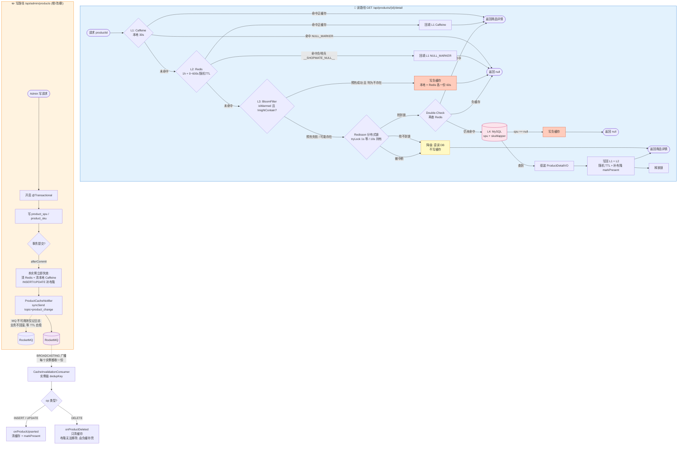

# 多级缓存

四级缓存纵深防御：Caffeine、Redis、BloomFilter、DB

## ProductDetailService.java

## ProductIdBloomFilter.java

## ProductWriteService.java

## ProductCacheNotifier.java

## CacheInvalidationConsumer.java

## CacheConstants.java

## IdempotentConsumer.java
